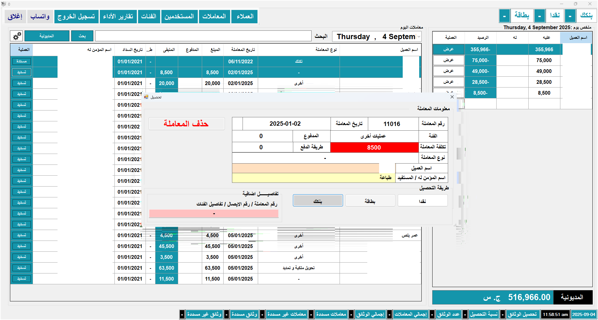
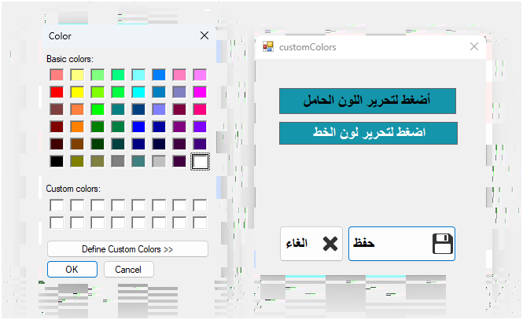
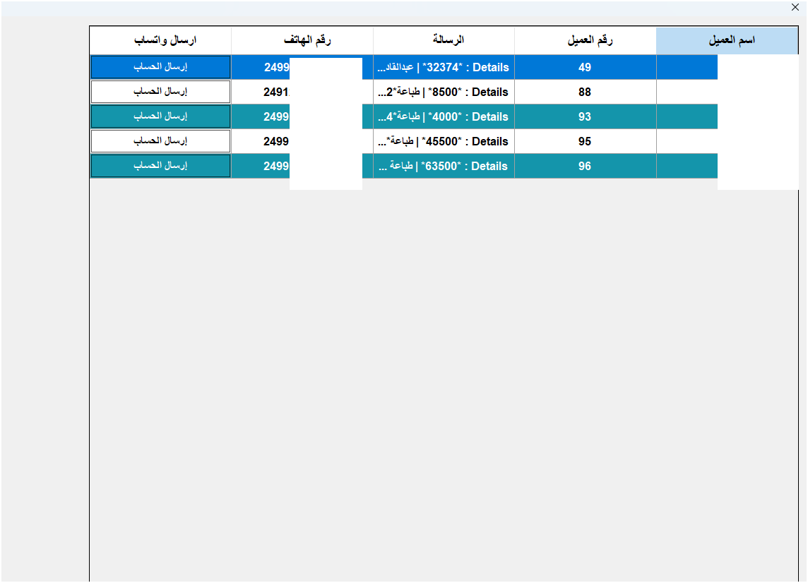

# 👥 Clients Manager | Client Management System

<p align="center">
  
</p>

---

## 🌍 In English

**Clients Manager** is a comprehensive desktop system for managing client data, tracking interactions, sending financial claims, and generating periodic reports. It is specifically designed to meet the needs of Sudanese offices and companies that handle a large number of clients and require organized communication and collection processes.

### ✳️ Key Features
- Add and edit client information  
- Categorize clients by activity or type  
- Log transactions and visits  
- Generate printable periodic reports  
- Fast search and filtering by name or date  

### 💬 Financial Claims & Follow-up
- Send personalized messages to clients with financial claim details  
- Support for SMS, WhatsApp, or email delivery  
- Record message history and response status within the client profile  

#### 📩 Sample Message:
> Dear client, this is a reminder for claim #1023 of SDG 4,500, due on September 10, 2025. Please contact us to complete theير، إليك الترجمة الإنجليزية الكاملة في شكل كود Markdown منسق، جاهز للاستخدام في ملف README أو صفحة مشروع:

```markdown
# 👥 Clients Manager | Client Management System

<p align="center">
  
</p>

---

## 🌍 In English

**Clients Manager** is a comprehensive desktop system for managing client data, tracking interactions, sending financial claims, and generating periodic reports. It is specifically designed to meet the needs of Sudanese offices and companies that handle a large number of clients and require organized communication and collection processes.

### ✳️ Key Features
- Add and edit client information  
- Categorize clients by activity or type  
- Log transactions and visits  
- Generate printable periodic reports  
- Fast search and filtering by name or date  

### 💬 Financial Claims & Follow-up
- Send personalized messages to clients with financial claim details  
- Support for SMS, WhatsApp, or email delivery  
- Record message history and response status within the client profile  

#### 📩 Sample Message:
> Dear client, this is a reminder for claim #1023 of SDG 4,500, due on September 10, 2025. Please contact us to complete the payment.  
> Office Management – +249912345678

---

## 🖼️ Screenshots

| Screen 1 | Screen 2 | Screen 3 |
|----------|----------|----------|
| ! payment.  
> Office Management – +249912345678

---

## 🖼️ Screenshots

| Screen 1 | Screen 2 | Screen 3 |
|----------|----------|----------|
|  |  |  |

| Screen[](screenshot/logo.png) |  |  |

| Screen 4 | Screen 5 | Screen 4 | Screen 5 | Screen 6 |
|---------- 6 |
|----------|----------|----------|
|  |  |  |  |

| Screen 7 | Screen 8 | Screen 9 |
|----------|----------|----------|
|  |  |  |

| Screen 10 | Screen 11 | Screen 12 |
|-----------|-----------|-----------|
|  |

---

%288%29.png) |  |

| Screen 10 | Screen 11 | Screen 12 |
|-----------|-----------|-----------|
|  |

---

## 🏗️ Project Structure

```bash
Clients-Manager/
├── README.md           # Project description
├── LICENSE             # Usage license (MIT)
├── screenshot/         # System screenshots
├──## 🏗️ Project Structure

```bash
Clients-Manager/
├── README.md           # Project description
├── LICENSE             # Usage license (MIT)
├── screenshot/         # System screenshots
├── db/                 # Database files
├── src/                # Source code
